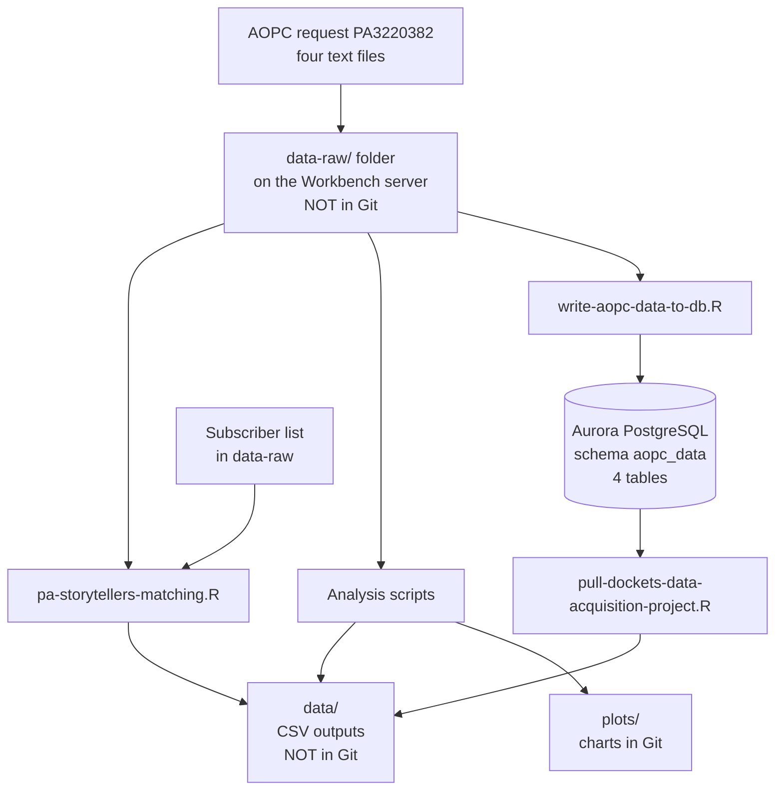

# AOPC Data: Pennsylvania Probation Court Records

R code that REFORM Alliance uses to load, clean and analyze court records from the Administrative Office of Pennsylvania Courts (AOPC). We bought the records to see how Pennsylvania's Act 44 is being carried out. Act 44 took effect on June 11, 2024. It changed the rules on two things: early termination of probation, and incarceration for technical probation violations.

This repository holds **code and charts only**. It holds no court records, and it must never hold any (see [Handle the data with care](#handle-the-data-with-care)).

> **Before you push anything.** Two scripts in `R/` still have the database host, user name and password typed into the code. Move them to environment variables (see [Connect to the database](#connect-to-the-database)) and change the password. `.gitignore` also does not yet list `data-raw/` and `data/`; add both so that court records cannot be committed by accident.

## Why we have this data

Act 44 has two measurable effects: **early termination of probation** and **jail or prison time for technical violations**. Pennsylvania has no statewide probation agency, so AOPC, which collects the records of all 67 county court systems, is the only statewide source. REFORM's data decision memo (September 30, 2025) lays out the plan:

- *Case, sentence and disposition records* give the **denominator**: how many people are on probation, for how long, and how that changed over time.
- *Docket entries* (what was filed in each case, and when) give the **numerator**: early terminations, revocations, violation hearings.
- Comparing counties shows where Act 44 is and is not being used, so REFORM knows where to offer help.

## What AOPC data can and cannot tell you

Read this before quoting any number from this repository. REFORM's January 2026 memo "Measuring Act 44 Implementation" explains the limits:

- AOPC combines records from 67 county court systems, and each county names and records probation events differently. Docket entries about ending probation are **not standardized** and often cannot be told apart.
- Many of the largest counties **do not record probation terminations in court dockets at all**. Eligibility, termination and good-behavior credits are tracked inside county probation offices, which never send them to the state.
- So AOPC data alone **cannot give a rate of early termination**, and cannot say who was eligible. Counts of early-termination docket entries are a floor, and they are lower in counties that record less. [Why we cannot find every early termination](#why-we-cannot-find-every-early-termination) lists the specific problems.
- Technical-violation charts are built from sentences, not from violation findings (see [How the two measures are built](#how-the-two-measures-are-built)).

The longer-term answer is county-level data. A draft task order for the research firm RTI International ("Task 2: Pennsylvania Data Acquisition and Analysis") proposes getting data from 8 to 12 county probation offices, up to 250 hours and $75,000. The copy in Drive is a draft with comments, so confirm what was signed.

## What the data is

### The request

| Detail | What the request form says |
| --- | --- |
| Request | AOPC Public Access Nonrecurring Request **PA3220382**, signed by Basil Seif on October 28, 2025 |
| Which cases | Criminal cases **disposed with a conviction and a sentence of probation**, from January 1, 2018 to the end of October 2025 |
| What is included | Defendant, offense, disposition, sentencing, case calendar events and docket entries for those cases |
| Docket entries | Only entries chosen from AOPC's drop-down list. No free-text fields |
| Where to send questions | AOPC Information Technology, Public Access Unit, ediin@pacourts.us |
| Cost | AOPC charges $80 per hour of staff time. The AOPC cost section on the copy in Drive is blank, so the amount paid is not recorded here. The decision memo estimated about $6,100 to $6,260 to start and about $1,540 to $1,700 per quarter for updates, based on a different plan: four standard files plus a special docket-entry request |

People who were not sentenced to probation, and cases disposed after October 2025, are not in the files. The form does not say whether Magisterial District Court (MDJ) cases are included. The one docket number in the code (`CP-01-CR-…`) is a Common Pleas number. Check this before saying anything about misdemeanors.

### The four files

AOPC delivered four text files, saved in a folder called `data-raw/`. The scripts find each file by the end of its name. Column names below are the ones the scripts use after `janitor::clean_names()` (lower case, underscores).

| File (name ends with) | Size as delivered | Holds | Columns the scripts use |
| --- | --- | --- | --- |
| `PA3220382_ReformAlliance_DocketEntryData.txt` | 937 MB | One row per docket entry | `docket_number`, `filed_date`, `official_docket_entry` |
| `…_CaseandDispositionData.txt` | 229 MB | One row per offense disposition, with the defendant | `docket_number`, `county`, `offense_sequence_number`, `case_disposition_date`, `defendant_name`, `defendant_dob`, `defendant_city`, `defendant_state` |
| `…_SentenceData.txt` | 188 MB | One row per sentence | `docket_number`, `originating_offense_sequence_number`, `offense_sequence_number`, `sentence_date`, `effective_sentence_date`, `sentence_type`, `sentencing_event_type`, `sentence_period`, `program_type`, `min_years`, `min_months`, `min_days`, `max_years`, `max_months`, `max_days` |
| `…_CalendarData.txt` | 297 MB | Court calendar events (hearings) | Loaded into the database. No script uses it yet |

A docket number (for example `CP-01-CR-0000125-2020`) identifies one court case. A person can have several.

A fifth file, `GEN_2018_2023_SID_SUB.csv` (1.4 GB), was also in `data-raw/`. **No script in this repository reads it** and I could not tell what it is. The name and years suggest it may be the Pennsylvania Commission on Sentencing data that the December 4, 2025 check-in notes say had just arrived. Confirm before relying on that.

A sixth file, a list of REFORM's Pennsylvania subscribers named `pa-subscribed-list-jan2026…` (columns such as `nationbuilder_id` suggest a NationBuilder export), is read by `pa-storytellers-matching.R`.

### AOPC's own conditions

The request form carries a disclaimer. Two points matter for how we use the data:

- The records **are not supported by fingerprints**, so AOPC says they "should not be used for the purposes of linking cases to specific individuals".
- AOPC **does not send updates, corrections or expungements**. The recipient is responsible for complying with every order to expunge or correct the data it received.

## How the pieces fit



Only one script reads from the database (`pull-dockets-data-acquisition-project.R`). The others read the raw files directly.

### The scripts

| Script | What it does | Writes |
| --- | --- | --- |
| `write-aopc-data-to-db.R` | Cleans the four files lightly and loads them into the `aopc_data` schema as four tables: `docket_entry_df`, `calendar_df`, `case_disposition_data_df`, `sentence_data_df`. | Database tables |
| `apoc-data-cleaning.R` | Lists every docket-entry type and marks which ones count as ending probation. Counts early terminations by county and month from June 2025. Counts "Probation Status Report" entries and what follows them. | `data/docket_entries_by_count.csv` |
| `technical-violation-exploration_shareable.R` | The clean, current version of the technical-violation analysis, statewide and by county. | `data/tv_reincarceration_by_month_and_county.csv` and charts in `plots/` |
| `technical-violation-exploration_v2.R` | The same charts, plus Allegheny and Philadelphia versions and a version without the smoothing line. | Charts in `plots/` |
| `technical-violation-exploration.R` | The first version, with exploratory sections. Superseded. | Charts in `plots/` |
| `basil-brian-pa-investigation.R` | Montgomery County early-termination counts, and a function, `pull_docket_entry_type()`, that pulls the full docket and sentence timeline for cases with a chosen docket-entry type (for example "Order Granting Early Release"). | Nothing |
| `basil-brian-pa-investigation_v2.R` | Docket entries by type and month, a table for Allegheny, and a check for duplicate probation sentences. | `data/allegheny_by_date_docket_entry_type.csv` (see [Known issues](#known-issues)) |
| `pa-storytellers-matching.R` | Matches REFORM's Pennsylvania subscriber list against defendants, in four rounds, and flags who had a probation sentence, a termination, or an early termination. | `data/pa-subscribers/pa-subscriber-matches-4-rounds.csv` |
| `pull-dockets-data-acquisition-project.R` | Draws two random samples of 100 Chester County cases, one before and one after June 11, 2024 (presumably for reviewing the dockets by hand). It keeps people with a single docket whose hearing notices, filed after a guilty plea, all fall on one side of that date. Reads from the database. | `data/chester_county_dockets_before_effective_date.csv` and `…_after_effective_date.csv` |

## How the two measures are built

These descriptions come from reading the code. I could not run it.

### Early termination (from docket entries)

1. `apoc-data-cleaning.R` takes every docket-entry type whose name contains "Probation" and "Termin". It drops denials, requests, responses, briefs, scheduling entries, and the two entries that only *ask* for early termination ("Motion for Early Termination of Probation" and "Petition for Probation Review for Early Termination").
2. Each remaining entry is sorted into one of three groups:
   - **Early termination**: the entry name contains "Early" or "Act 44".
   - **Terminated at a violation hearing**: "Probation/Parole Violation Held - Probation/Parole Terminated".
   - **Natural expiration**: "Probation Terminated - Natural Expiration".
   Anything else is left as `possible_early_term`: a termination entry that does not clearly fit any group.
3. It counts each case once per entry type (in the latest month the entry appears), by county and month. The counts in `apoc-data-cleaning.R` start in June 2025; the investigation scripts use other start dates.

These steps depend on entry names, so read [Why we cannot find every early termination](#why-we-cannot-find-every-early-termination) before using the counts. Run the script to get `data/docket_entries_by_count.csv`. It lists every entry type, how often it appears, and `in_use = 1` if the script counts it. A legal reviewer can use it to judge which entries should count.

### Incarceration after a violation (from sentences)

1. Drop "No Further Penalty" sentences and merge exact duplicates.
2. For each case and offense, line up the sentences with the disposition records in date order. A sentence that matches a disposition is the **original sentence**. Sentences beyond that are **later sentences**. The code calls these "tv", for technical violation.
3. For each month and county, count the later sentences and the cases they sit on, and how many are `Confinement`.
4. **The rate** is confinement later sentences divided by all later sentences, calculated two ways: by cases ("Probationers") and by sentence records ("Probation Sentences").
5. Charts start in January 2019.

What to keep in mind:

- **A later sentence is a stand-in for a violation, not a confirmed technical violation.** No script filters on `sentencing_event_type` (the filter in the first script is commented out). The reason for the later sentence is not checked. Chart titles that say "technical violations" are shorthand.
- **"Probationers" are court cases, not people.** The count is of distinct docket numbers, and AOPC data cannot reliably tell people apart.
- **The latest months swing sharply.** The statewide chart's last few points jump upward. Cases disposed after October 2025 are not in the data, so recent months are probably incomplete. Do not read them as a trend.

## Why we cannot find every early termination

An early termination can only show up in the AOPC files as a docket entry, and counties do not record these entries the same way. The problems below are listed roughly from most to least serious. The note after each says where it comes from.

1. **Some counties do not record terminations in dockets at all** (January 2026 memo). Many of the largest counties keep termination, eligibility and good-behavior credit information inside the county probation office. For those counties the data shows few or no terminations, and the count cannot tell "none happened" from "none were recorded".
2. **Counties name the same event differently** (January 2026 memo, and the code). The memo says docket entries about probation termination are not standardized and often cannot be reliably identified. The scripts find them by name: an entry counts if it contains "Probation" and "Termin", and it counts as an early termination if its name also contains "Early" or "Act 44". An early termination recorded under a name that fails that test is missed. For example, `basil-brian-pa-investigation.R` pulls "Order Granting Early Release" as an example, and that name contains neither "Probation" nor "Termin", so the filter would skip it. Whether such an entry is an early termination is not known.
3. **Generic entries cannot be sorted** (the code). Every termination entry that does not say "Early", "Act 44", "Natural Expiration" or a violation hearing goes into the `possible_early_term` group. If a county records all terminations under one generic entry, its early terminations are mixed in with its ordinary ones. The scripts label an entry by its name only. They never compare the termination date with the date the sentence would have ended.
4. **Free-text detail is not in the data** (the request form). We asked only for docket entries chosen from AOPC's drop-down list, with no free-text fields. A county that notes an early termination only in free text would not show up. We do not know how often that happens.
5. **People sentenced before 2018 are missing** (the request form). The files cover only cases disposed from January 2018 on. Someone on a long probation sentence imposed earlier, who was ended early after Act 44, is not in the files.
6. **We cannot count who was eligible** (January 2026 memo). Eligibility, status-report recommendations, good-behavior credits and time left on the sentence are not in dockets. The "Probation Status Report" entries the scripts count are only a stand-in for those reports, and they have problems 1 and 2 as well. Without the people who could have been terminated, there is no rate.
7. **It is unclear whether both court systems are included** (the request form). The form does not say whether Magisterial District Court (MDJ) cases are covered, and any gap there would add to the problems above.
8. **AOPC does not stand behind the data** (the request form). Its disclaimer makes no representation about accuracy or completeness, and it sends no updates or corrections.

### How to use the counts

- Treat a county's count as a minimum when the county records terminations in dockets, and as unknown when it does not.
- Compare a county with its own earlier months rather than with other counties. Recording practices differ between counties, though a county may also change its entry names over time.
- Do not describe a count as a rate or a share of those eligible.

### Checks that would show which counties can be trusted (not done yet)

These are suggestions. Nothing in the repository does them.

1. For each county, count termination entries by type and month, and set them beside that county's number of probation sentences. A county with none, or very few, probably does not record terminations in dockets.
2. Go through the full list of entry names in `data/docket_entries_by_count.csv` with a clerk or probation officer, looking for names the filter misses.
3. Ask county probation offices directly, which is what the RTI task order proposes.

## Set up and run

### Where things are

The working copy lives on the Posit Workbench server (reachable only on the VPN or from the office) at `~/implementation/pennsylvania/aopc-data`, in Basil Seif's home directory. The raw files in `data-raw/` are there too. **If that account is removed or locked, the raw files go with it.** The tables in the `aopc_data` database schema hold a second copy. Record where else the original delivery is kept.

### Steps

1. Get the project onto the server (clone this repository) and open `aopc-data.Rproj` in Workbench.
2. R starts `renv` automatically (`.Rprofile`). Run `renv::restore()` once. `renv.lock` pins R 4.5.0 and 124 packages, including `data.table`, `tidyverse`, `janitor`, `here`, `DBI`, `RPostgres`, `dbplyr`, `fastLink`, `fuzzyjoin` and `stringdist`.
3. Create the folders the scripts expect, which Git does not keep: `data-raw/` (put the four AOPC files here), `data/`, and `data/pa-subscribers/`. `plots/` is already in the repository. `fwrite()` and `ggsave()` fail if their folder is missing.
4. Run scripts from the project root, so `here()` finds the folders. `write-aopc-data-to-db.R` goes first if the database needs filling. The analysis scripts do not depend on each other, except the Chester sampler, which needs the database tables.

The scripts load whole files into memory. `DocketEntryData` alone is 937 MB on disk, so use a session with several gigabytes of RAM.

### Connect to the database

The database is REFORM's Aurora PostgreSQL cluster in the AWS environment, reached from the Workbench server (see the AWS documentation). Put the connection details in `~/.Renviron` on the server, never in a script or in Git:

```
AOPC_DB_HOST=<cluster endpoint>
AOPC_DB_USER=<your own database user>
AOPC_DB_PASSWORD=<your password>
```

Then connect like this:

```r
con <- dbConnect(
  RPostgres::Postgres(),
  host     = Sys.getenv("AOPC_DB_HOST"),
  port     = 5432,
  user     = Sys.getenv("AOPC_DB_USER"),
  password = Sys.getenv("AOPC_DB_PASSWORD")
)
```

`write-aopc-data-to-db.R` and `pull-dockets-data-acquisition-project.R` have **not** been changed to this yet. Both connect as the database's main `postgres` user. Create a separate user for analysis, and a separate one for loading.

## Update the data

1. Request a new extract from AOPC with a new nonrecurring request. The form says AOPC charges $80 an hour, with a one-hour minimum.
2. Put the new files in `data-raw/`. The scripts pick files by the end of the name, so remove or move the old files first, or the script will read more than one.
3. Run `write-aopc-data-to-db.R`. For a table that already exists it writes the new rows to a temporary table, joins old and new with `UNION ALL … DISTINCT`, builds a new table, drops the old one and renames the new one.

**This loader only adds rows.** A record that AOPC corrected shows up twice (old and new version), and a record that was later expunged stays in the database. AOPC's disclaimer puts that responsibility on us. The drop-and-rename is not wrapped in a transaction, so a failure part way could leave the table missing. Take a backup before loading.

## Folders and files

| Path | What it is |
| --- | --- |
| `R/` | The scripts above |
| `plots/` | 12 charts, each as `.png` and `.pdf`. They show only counts and rates. `tv_imprisonment_by_sentence_type*` shows counts (all later sentences vs. confinement). `tv_total_imprisonment_rates_by_rate_type*` shows the statewide rate; the `_allegheny` and `_philadelphia` versions show those counties. `tv_imprisonment_rates_by_county*` has one panel per county |
| `renv.lock`, `renv/`, `.Rprofile` | Package versions and startup |
| `aopc-data.Rproj` | RStudio / Workbench project file |
| `data-raw/` | **Not in Git.** The AOPC files |
| `data/` | **Not in Git.** Outputs that can contain case or personal information |

The charts in `plots/` are smoothed trend lines unless the file name ends in `_v2`. The smoothing hides month-to-month noise and widens at the ends.

## Handle the data with care

- `data-raw/` holds defendant names, dates of birth and cities. The files are too big for GitHub (limit 100 MB per file; all five large files exceed it) and must not be uploaded anywhere, including a private repository. Keep them on the Workbench server and in the Aurora database.
- Outputs in `data/` can also carry personal details. `pa-subscriber-matches-4-rounds.csv` has email addresses and phone numbers; the Chester files have docket numbers.
- **The subscriber matching goes against AOPC's own warning.** `pa-storytellers-matching.R` links people by name and county, and in rounds two and four by name only. AOPC says its records should not be used to link cases to specific individuals. A match can be wrong, and contacting someone about a court record they did not share with us is sensitive in itself. Have the results reviewed by legal before anyone is contacted based on a match. Rounds two and four, which match on name alone, are the least reliable.
- Obey expungement orders (see above).

## Known issues

- **Database credentials are in the code.** Two scripts contain the host, the `postgres` user and its password. The password was committed to this repository's history, so treat it as exposed: change it, and clean the history (or recreate the repository) if the repository is public.
- **`.gitignore` is incomplete.** It lists only RStudio files. Add `data-raw/` and `data/`.
- **The v2 investigation script returns nothing for Allegheny.** `basil-brian-pa-investigation_v2.R` filters to Montgomery (line 122) before the Allegheny step (line 155), so the Allegheny table will be empty or the script will stop. Change the first filter to Allegheny.
- **The three technical-violation scripts write the same file names.** Whichever ran last wins, so the charts in `plots/` cannot be traced to one script. Only the `_shareable` script writes the CSV.
- **What the technical-violation charts are built from.** The February and March 2026 check-in notes describe them as made with "PA sentencing commission data". The scripts here read the AOPC sentence and disposition files. Confirm which before presenting them.
- **"Fourth Round" in the matching script is mislabeled.** Its comment copies round three's. It matches on name alone, with middle initials removed.
- **`psrs_allegheny`** in `apoc-data-cleaning.R` has no Allegheny filter. It covers every county.
- **File name typo.** `apoc-data-cleaning.R` should read `aopc`. Left as it is so existing references keep working.
- **Duplicate sentences are not cleaned.** `basil-brian-pa-investigation_v2.R` finds probation sentences that appear twice, and the "Clean Up Sentence Data" step at its end is an empty placeholder.
- **`GEN_2018_2023_SID_SUB.csv`** is not read by any script (see above).
- **Most scripts read raw files, not the database.** They reload and clean up to about 1.6 GB each time. Reading from `aopc_data` would be quicker and would keep the raw files closed.

## Where the project stands

Done: the request, the database load, early-termination counts by county and month, technical-violation charts statewide and for Allegheny, Philadelphia and every county, subscriber matching, and the Chester sample.

Open, as recorded in the check-in notes and memos (through November 2026):

- AOPC data cleaning is long-running. The January 2026 memo calls it the top priority after the Department of Labor deliverables and says data quality problems are "substantial".
- A **linked sentences** request to AOPC was pending in February and March 2026.
- A meeting with the Pennsylvania Commission on Sentencing about the technical problems in AOPC data was scheduled in July 2026.
- County-level data is being pursued with RTI and GovAI, and with individual counties.
- The Pennsylvania state dashboard does not exist yet. The memo's plan is to merge cleaned AOPC data with other state sources.
- No later AOPC delivery is recorded here. The loader is built to accept one.

## Sources

- AOPC Data Decision Memo (September 30, 2025)
- PA3220382 request form, signed October 28, 2025 (Drive: `PA3220382_ReformAlliance_ReqeustForm`, also `REFORM_AOPC_ad_hoc_data_request`)
- Measuring Act 44 Implementation: Priority Metrics and Data Challenges (January 20, 2026)
- Pending Data Science Work at REFORM, memo (January 20, 2026)
- Task Order, Pennsylvania (RTI Task 2), draft
- Bi-Weekly Data Science Check-In agenda (running notes, June 2025 to November 2026)
- The scripts and charts in this repository